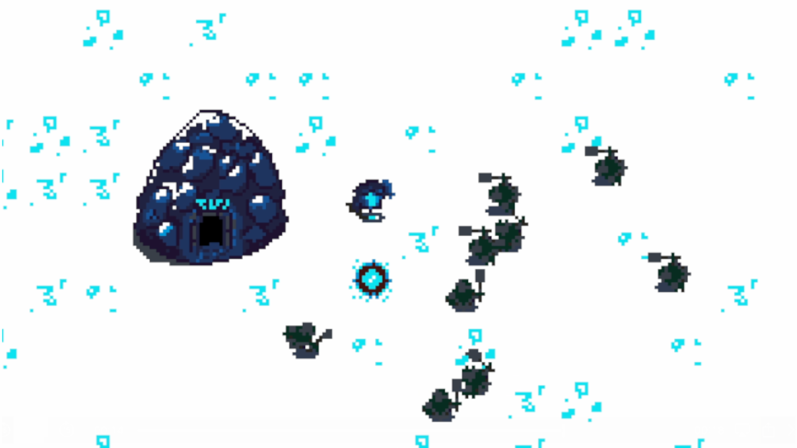

# Aftrganga

A top-down horde shooter game made for the
[Firefly Zero retro inspired handheld console](https://fireflyzero.com/)
for the [Firefly Zero Game Jam #3](https://itch.io/jam/firefly-jam-3).

Play as an aftrganga protecting their haugr against the horde of evil viking
grave robbers.

The aftrganga, or draugr, is a malevolent revenant that lives in a barrow
guarding the treasure horde buried inside. It's a corporeal undead ghost
of the deceased buried within the grave mound.

## Keyboard controls

- Arrow keys: move your draugr.
- X or Enter: shoot.
- TAB: Open menu to restart game.
- Escape: close the game.

## Credits

### Code

- Olle Wreede
- boots

### Graphics

- boots

### Music

- The Cynic Project / cynicmusic.com / pixelsphere.org

## License

This game is released under the [MIT License](LICENSE).
